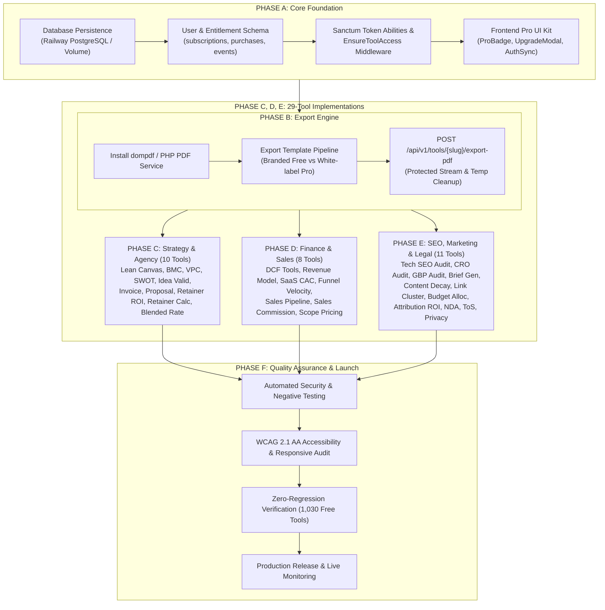

# Vimz.ai — 29-Tool Implementation Roadmap
**Phase 2: Master Phased Implementation Plan for All 29 Verified Premium Candidate Tools**

* **Status:** Complete Planning Document (Zero Code Changes — Awaiting Executive Approval)
* **Date:** October 12, 2026
* **Platform Scope:** Vimz.ai (1,059 Total Tools; 1,030 100% Free; 29 Hybrid Pro Candidates)
* **Target Architecture:** React 19 / Vite SPA (Netlify) + Laravel 13 / Sanctum API (Railway)
* **Associated Documents:**
  - Architecture: [`05-hybrid-monetization-architecture.md`](file:///c:/Users/ranah/OneDrive/Desktop/vimztools/reports/vimz-ai-freemium-audit/05-hybrid-monetization-architecture.md)
  - Tool-by-Tool Boundaries: [`06-free-premium-feature-boundaries.md`](file:///c:/Users/ranah/OneDrive/Desktop/vimztools/reports/vimz-ai-freemium-audit/06-free-premium-feature-boundaries.md)
  - Infrastructure & Security: [`07-infrastructure-security-and-testing-plan.md`](file:///c:/Users/ranah/OneDrive/Desktop/vimztools/reports/vimz-ai-freemium-audit/07-infrastructure-security-and-testing-plan.md)
  - Executive Approval Checklist: [`08-open-decisions-and-approval-checklist.md`](file:///c:/Users/ranah/OneDrive/Desktop/vimztools/reports/vimz-ai-freemium-audit/08-open-decisions-and-approval-checklist.md)

---

## 1. Executive Summary & Scope

Sir has established the core monetization strategy for Vimz.ai:
1. **Basic functionality remains 100% FREE forever.**
2. **Genuinely advanced functionality will be PREMIUM (PAID).**
3. **Free exports carry subtle *"Created with Vimz.ai"* branding.**
4. **Premium users receive 100% unbranded white-label client exports.**
5. **Monetization supports both Monthly All-Access and Individual Tool Purchases.**
6. **Implementation planning must cover ALL 29 Premium Candidate Tools.**

### Verification Baseline
The 6 commodity tools previously flagged during validation (`instagram-grid-carousel-splitter`, `robots-sitemap-generator`, `schema-json-ld-generator`, `seo-redirect-map-builder`, `commercial-lease-rent-calculator`, and `cold-email-outreach-planner`) have been **strictly excluded** from the Pro scope and preserved as 100% Free.

The remaining **29 candidate tools** are organized into a sequenced, 6-phase engineering roadmap designed to deliver maximum business value with zero regression risk to the existing 1,059 tools.

---

## 2. End-to-End Implementation Dependency Graph

---

## 3. Phased Implementation Breakdown

### Phase A: Shared Entitlement & Monetization Foundations
* **Objective:** Establish the data models, authentication mechanisms, and UI components needed to manage and check user entitlements without altering any existing tool logic.
* **Tools / Systems Covered:**
  - Backend database layer (Railway PostgreSQL or SQLite Persistent Volume).
  - Schema migrations: `subscriptions`, `purchases`, `payment_events`, `tool_entitlements`.
  - Middleware: `EnsureToolAccess` (checks both active monthly subscription AND individual tool purchase records).
  - Frontend UI Kit: Reusable `<ProBadge />`, `<UpgradeModal />`, `<FeatureLock />`, and `useEntitlement(toolSlug)` hook.
* **Dependencies & Prerequisites:**
  - Provisioned database persistence on Railway.
  - Laravel Sanctum configuration verified.
* **Complexity:** **Medium** | **Risk:** **Low** (isolated to new backend tables and new shared UI components).
* **Test Requirements:**
  - Unit tests for `EnsureToolAccess` with: (1) guest, (2) user with no pass, (3) user with valid single-tool pass, (4) user with active subscription, (5) user with expired subscription.
* **Completion Criteria:** User can log in, view purchase history in dashboard, and frontend accurately reflects access status via mock entitlement state.
* **Rollback Strategy:** Revert new migration batch; zero tool component files are touched.

---

### Phase B: Export Branding & Secure Export Infrastructure
* **Objective:** Build the server-side export pipeline capable of generating clean PDFs with subtle *"Created with Vimz.ai"* footers for free users, and 100% unbranded white-label PDFs for paid users.
* **Tools / Systems Covered:**
  - Backend PDF rendering engine (`dompdf` via `barryvdh/laravel-dompdf` or standalone service).
  - Blade template engine for clean typography, headers, page breaks, and footers.
  - Endpoint: `POST /api/v1/tools/{slug}/export-pdf`.
  - Automated cron/temp file cleanup job for generated files.
* **Dependencies & Prerequisites:** Phase A complete.
* **Complexity:** **Medium** | **Risk:** **Low-to-Medium** (memory limits on large documents).
* **Test Requirements:**
  - Verify free export includes subtle footer citation: *"Created with Vimz.ai — Free Professional Business Tools"*.
  - Verify paid export omits all Vimz.ai citations and embeds custom agency logo and company name.
  - Verify request without entitlement returns `403 Forbidden` with upgrade payload.
* **Completion Criteria:** Export endpoint generates sub-second PDF deliverables and cleans temporary disk storage automatically.
* **Rollback Strategy:** Disable export route; client continues falling back to browser print dialog (`window.print()`).

---

### Phase C: Strategy, Business & Agency Deliverables (10 Tools)
* **Objective:** Implement advanced Pro capabilities on the highest-demand agency and entrepreneurial strategy tools.
* **Tools Covered (10 Tools):**
  1. `business-model-canvas-builder` (ID 1044, `src/tools/business/BusinessModelCanvasBuilder.jsx`)
  2. `lean-canvas-business-builder` (ID 1030, `src/tools/business/LeanCanvasBusinessBuilder.jsx`)
  3. `value-proposition-canvas-mapper` (ID 1045, `src/tools/business/ValuePropositionCanvasMapper.jsx`)
  4. `swot-analyzer` (ID 875, `src/tools/productivity/SwotAnalyzer.jsx`)
  5. `business-idea-validation-planner` (ID 1047, `src/tools/business/BusinessIdeaValidationPlanner.jsx`)
  6. `invoice-generator` (ID 27, `src/tools/office/InvoiceGenerator.jsx`)
  7. `agency-pitch-proposal-generator` (ID 1036, `src/tools/freelance/AgencyPitchProposalGenerator.jsx`)
  8. `client-retainer-roi-report-generator` (ID 1059, `src/tools/freelance/ClientRetainerRoiReportGenerator.jsx`)
  9. `agency-retainer-calculator` (ID 1034, `src/tools/freelance/AgencyRetainerCalculator.jsx`)
  10. `agency-blended-rate-calculator` (ID 1039, `src/tools/freelance/AgencyBlendedRateCalculator.jsx`)
* **Existing Features Preserved (100% Free):**
  - Full interactive editing, on-screen card addition, math calculations, local state saves, standard clipboard copy, browser print dialogs, and existing CSV/JSON downloads.
* **New Advanced Pro Features Added:**
  - Executive vector PDF presentation exports (Strategyzer format, SWOT TOWS matrix).
  - Agency white-labeling: custom company logo, custom brand accent color, client company name, e-signature blocks.
  - Multi-canvas portfolio saving (store multiple client canvases in database).
* **Dependencies & Prerequisites:** Phase A and Phase B complete.
* **Complexity:** **High** | **Risk:** **Low** (each component adopts the shared export modal modularly).
* **Test Requirements:** Automated component render tests; export payload validation; visual regression of print output.
* **Completion Criteria:** Agency users can generate customized, unwatermarked client proposals, invoices, and strategy canvases with their own branding.

---

### Phase D: Financial Modeling & Enterprise Sales Forecasting (8 Tools)
* **Objective:** Enable multi-scenario sensitivity modeling, long-term projections, and exportable financial models.
* **Tools Covered (8 Tools):**
  11. `discounted-cash-flow-dcf-valuation-tool` (ID 316, `src/tools/finance/DiscountedCashFlowDcfValuationTool.jsx`)
  12. `dcf-valuation-calc` (ID 1010, `src/tools/finance/DcfValuationCalcTool.jsx`)
  13. `revenue-model-comparison-calculator` (ID 1048, `src/tools/business/RevenueModelComparisonCalculator.jsx`)
  14. `saas-cac-payback-matrix` (ID 1032, `src/tools/business/SaasCacPaybackMatrix.jsx`)
  15. `sales-funnel-velocity-calculator` (ID 1031, `src/tools/business/SalesFunnelVelocityCalculator.jsx`)
  16. `sales-pipeline-stage-planner` (ID 1046, `src/tools/business/SalesPipelineStagePlanner.jsx`)
  17. `sales-commission-calculator` (ID 1033, `src/tools/business/SalesCommissionCalculator.jsx`)
  18. `project-scope-pricing-estimator` (ID 1049, `src/tools/freelance/ProjectScopePricingEstimator.jsx`)
* **Existing Features Preserved (100% Free):**
  - Full intrinsic valuation math, CAC payback formulas, velocity formulas, baseline commission calculations, and existing CSV exports.
* **New Advanced Pro Features Added:**
  - Multi-scenario sensitivity tables (Bull / Base / Bear case side-by-side).
  - 5-year longitudinal financial forecast tables.
  - Investor-ready financial valuation summary PDF.
  - Sales commission compensation plan schedule PDF.
* **Dependencies & Prerequisites:** Phase A and Phase B complete.
* **Complexity:** **Medium** | **Risk:** **Low** (mathematical functions remain pure client-side functions).
* **Test Requirements:** Formula accuracy verification across all edge cases (zero values, negative growth, extreme discount rates).
* **Completion Criteria:** Financial modelers can toggle scenarios and export board-ready valuation summaries.

---

### Phase E: SEO, Growth, Marketing & Legal Agreements (11 Tools)
* **Objective:** Implement client-ready audit reports, editorial specs, and formal legal agreement exports.
* **Tools Covered (11 Tools):**
  19. `technical-seo-audit-checklist` (ID 1051, `src/tools/marketing/TechnicalSeoAuditChecklist.jsx`)
  20. `landing-page-audit-checklist` (ID 1053, `src/tools/marketing/LandingPageAuditChecklist.jsx`)
  21. `local-seo-gbp-audit-planner` (ID 1056, `src/tools/marketing/LocalSeoGbpAuditPlanner.jsx`)
  22. `content-brief-generator` (ID 1052, `src/tools/marketing/ContentBriefGenerator.jsx`)
  23. `seo-content-decay-audit-calculator` (ID 1042, `src/tools/marketing/SeoContentDecayAuditCalculator.jsx`)
  24. `internal-linking-cluster-architect` (ID 1054, `src/tools/marketing/InternalLinkingClusterArchitect.jsx`)
  25. `campaign-budget-allocator` (ID 1055, `src/tools/marketing/CampaignBudgetAllocator.jsx`)
  26. `marketing-attribution-roi-model` (ID 1035, `src/tools/freelance/MarketingAttributionRoiModel.jsx`)
  27. `nda-generator` (ID 380, `src/tools/legal/NdaGenerator.jsx`)
  28. `terms-of-service-generator` (ID 388, `src/tools/legal/TermsOfServiceGenerator.jsx`)
  29. `privacy-policy-generator` (ID 389, `src/tools/legal/PrivacyPolicyGenerator.jsx`)
* **Existing Features Preserved (100% Free):**
  - Full 24-point audit scoring, on-screen recommendations, plain-text brief copying, legal clause drafting, and existing CSV/text downloads.
* **New Advanced Pro Features Added:**
  - Agency client SEO/CRO audit report PDF with executive scorecard and prioritized fix roadmap.
  - Formatted editorial brief PDF with writer acceptance checklist.
  - Legally structured NDA/Contract PDF with formatted signature blocks and jurisdiction clauses.
* **Dependencies & Prerequisites:** Phase A and Phase B complete.
* **Complexity:** **Medium** | **Risk:** **Low**.
* **Test Requirements:** Audit scoring consistency tests; legal PDF layout verification across single-page and multi-page agreements.
* **Completion Criteria:** SEO consultants and agencies can generate white-label audit reports for paying clients in 1 click.

---

### Phase F: Cross-Tool QA, Security Hardening, Accessibility & Rollout
* **Objective:** Comprehensive end-to-end verification across the entire platform.
* **Checklist:**
  - **Zero Regression Verification:** Run automated test suite across all 1,030 Free tools to guarantee zero breakage or unintended paywalls.
  - **Security Audit:** Verify that direct API calls to `/api/v1/tools/{slug}/export-pdf` cannot be bypassed without valid HMAC/Sanctum tokens.
  - **Accessibility Review:** Ensure `<UpgradeModal />`, Pro badges, and export buttons comply with WCAG 2.1 AA (keyboard navigable, screen reader labels, contrast compliance).
  - **Performance Benchmark:** Verify that shared Pro UI kit adds less than 15 KB to the production bundle size.
  - **Rollback Readiness:** Maintain clean Git feature branches for instant rollback if any unexpected issue arises.

---

## 4. Phase Summary & Complexity Matrix

| Phase | Title | Tool Count | Core Deliverables | Estimated Complexity | Risk Level |
| :---: | :--- | :---: | :--- | :---: | :---: |
| **A** | Entitlement & Monetization Foundations | Shared Infra | DB schema, Sanctum middleware, Pro UI kit, hooks | Medium | Low |
| **B** | Export Branding & PDF Engine | Shared Infra | `dompdf` service, branded free vs white-label pro templates | Medium | Low-Medium |
| **C** | Strategy & Agency Tools | 10 Tools | White-label BMC/Lean canvas, proposal & invoice PDF exports | High | Low |
| **D** | Financial & Sales Modeler Tools | 8 Tools | Multi-scenario sensitivity tables, DCF & SaaS CAC PDF models | Medium | Low |
| **E** | SEO, Marketing & Legal Tools | 11 Tools | Client audit PDF reports, editorial briefs, legal agreements | Medium | Low |
| **F** | Platform QA, Security & Launch | 29 Tools + 1,030 Free | Security penetration test, zero-regression audit, a11y review | Medium | Low |
| **TOTAL** | **Full Monetization Rollout** | **29 Pro Tools** | **Complete hybrid monetization across all 29 tools** | — | — |
