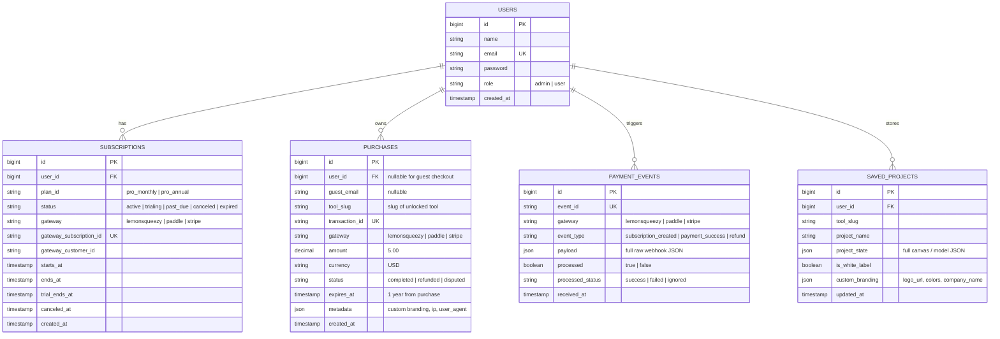

# Vimz.ai — Hybrid Monetization Architecture Specification
**Phase 2: Technical Architecture for Monthly Subscriptions, Single-Tool Purchases & Secure Entitlements**

* **Status:** Complete Planning Specification (Zero Code Changes — Awaiting Executive Approval)
* **Date:** October 12, 2026
* **Target Stack:** React 19 / Vite SPA (Netlify) + Laravel 13 / Sanctum API (Railway)
* **Scope:** 29 Verified Premium Candidate Tools (with 1,030 Tools Remaining 100% Free Forever)
* **Associated Documents:**
  - Roadmap: [`04-29-tool-implementation-roadmap.md`](file:///c:/Users/ranah/OneDrive/Desktop/vimztools/reports/vimz-ai-freemium-audit/04-29-tool-implementation-roadmap.md)
  - Tool-by-Tool Boundaries: [`06-free-premium-feature-boundaries.md`](file:///c:/Users/ranah/OneDrive/Desktop/vimztools/reports/vimz-ai-freemium-audit/06-free-premium-feature-boundaries.md)
  - Infrastructure & Security: [`07-infrastructure-security-and-testing-plan.md`](file:///c:/Users/ranah/OneDrive/Desktop/vimztools/reports/vimz-ai-freemium-audit/07-infrastructure-security-and-testing-plan.md)
  - Executive Approval Checklist: [`08-open-decisions-and-approval-checklist.md`](file:///c:/Users/ranah/OneDrive/Desktop/vimztools/reports/vimz-ai-freemium-audit/08-open-decisions-and-approval-checklist.md)

---

## 1. Executive Architecture Overview

Sir has mandated a **Hybrid Monetization Model**:
1. **Monthly All-Access Subscription:** One recurring payment unlocks advanced Pro features across all 29 tools.
2. **Individual Tool Purchases:** A one-time payment unlocks the advanced Pro features of a single specific tool.
3. **Basic Functionality Remains 100% Free:** Free users retain unhindered access to core calculations, on-screen results, and standard print/copy workflows across all 1,059 tools.

### The Security Golden Rule
> **"Never rely on client-side React UI state alone to secure paid functionality. While UI badges and modals guide honest users, all advanced deliverables (unwatermarked PDF generation, sensitive data modeling, and server-side exports) must be cryptographically verified and enforced on the Laravel backend."**

---

## 2. Hybrid Entitlement Model & Access Resolution

```
                               ┌────────────────────────────────────────────────────────┐
                               │                    User Action                         │
                               │           (e.g., Click 'Export White-label PDF')       │
                               └───────────────────────────┬────────────────────────────┘
                                                           │
                                                           ▼
                                      ┌──────────────────────────────────────────┐
                                      │        Frontend Client-Side Check        │
                                      │           `useEntitlement(slug)`         │
                                      └────────────┬─────────────────────────────┘
                                                   │
                        ┌──────────────────────────┴──────────────────────────┐
                        │ (User Has No Active Pass)                           │ (User Has Entitlement)
                        ▼                                                     ▼
         ┌─────────────────────────────┐                       ┌─────────────────────────────┐
         │ Show `<UpgradeModal />`     │                       │ Send Request to Backend     │
         │ - Option A: Tool Pass ($X)  │                       │ `POST /api/v1/tools/        │
         │ - Option B: All-Access ($Y) │                       │  {slug}/export-pdf`         │
         └─────────────────────────────┘                       │ `Authorization: Bearer ...` │
                                                               └──────────────┬──────────────┘
                                                                              │
                                                                              ▼
                                                               ┌─────────────────────────────┐
                                                               │  `EnsureToolAccess` (MW)    │
                                                               └──────────────┬──────────────┘
                                                                              │
                                        ┌─────────────────────────────────────┴─────────────────────────────────────┐
                                        │                                                                           │
                                        ▼                                                                           ▼
                         ┌─────────────────────────────┐                                             ┌─────────────────────────────┐
                         │ Has Active Subscription?    │                                             │ Has Valid Single Purchase?  │
                         │ `status == 'active'`        │                     OR                      │ `tool_slug == slug`         │
                         │ `expires_at > now()`        │                                             │ `expires_at > now()`        │
                         └──────────────┬──────────────┘                                             └──────────────┬──────────────┘
                                        │                                                                           │
                                        └─────────────────────────────────────┬─────────────────────────────────────┘
                                                                              │
                                                                              ▼
                                                                [ ACCESS GRANTED: 200 OK ]
                                                                Stream Unwatermarked PDF
```

### The Entitlement Evaluation Hierarchy
When a user attempts to execute a Pro action on a tool (`tool_slug`), the backend checks access in this exact order:
1. **Admin Override:** If `user->isAdmin() == true`, grant immediate Pro access.
2. **Active All-Access Subscription:**
   - Look up `subscriptions` where `user_id = user->id` AND `status IN ('active', 'trialing')` AND `expires_at > now()`.
   - If present $\to$ **GRANT ACCESS (All-Access Pass)**.
3. **Valid Individual Tool Purchase:**
   - Look up `purchases` where `(user_id = user->id OR email = verified_guest_email)` AND `tool_slug = request->tool_slug` AND `status = 'completed'` AND `expires_at > now()`.
   - If present $\to$ **GRANT ACCESS (Single Tool Pass)**.
4. **Denial:** If neither exists, return `403 Forbidden` with a standardized JSON response:
   ```json
   {
     "status": "error",
     "code": "ENTITLEMENT_REQUIRED",
     "message": "This advanced deliverable requires Pro access.",
     "tool_slug": "business-model-canvas-builder",
     "pricing_options": {
       "single_tool_pass": { "amount": 5.00, "currency": "USD", "type": "one_time" },
       "all_access_subscription": { "amount": 12.00, "currency": "USD", "type": "recurring_monthly" }
     }
   }
   ```

---

## 3. Database Schema for Hybrid Monetization



---

## 4. Subscription & Purchase Lifecycle Management

### 4.1 Subscription State Machine
* **Created / Active (`active`):** User completes checkout. Webhook `subscription_created` arrives $\to$ record inserted in `subscriptions` with `ends_at = current_period_end`.
* **Grace Period (`past_due`):** Payment renewal fails. Grace period of 3 days allows retry before revoking access.
* **Canceled (`canceled`):** User cancels subscription. Access remains granted until `ends_at` (end of current billing cycle).
* **Expired (`expired`):** Webhook `subscription_expired` arrives, or cron job detects `ends_at < now()`. Access is gracefully revoked. User drops back to the 100% Free tier without losing saved data.

### 4.2 Webhook Security & Idempotency Pipeline
Payment gateways send asynchronous HTTP POST notifications when subscriptions renew, fail, or cancel.
1. **Signature Verification:** Verify webhook payload signature using gateway HMAC secret (e.g., `X-Signature` header). Reject invalid signatures immediately with `401 Unauthorized`.
2. **Idempotency Guard:** Extract `event_id` from webhook header/payload.
   - If `PaymentEvent::where('event_id', $eventId)->exists()`, return `200 OK` immediately (prevents duplicate processing on retries).
3. **Atomic Processing:** Process subscription or purchase status inside a database transaction (`DB::transaction`).
4. **Audit Trail:** Save raw event JSON into `payment_events` for financial debugging and compliance.

---

## 5. Export Pipeline: Free Attribution vs. Pro White-Labeling

### 5.1 Free Export Specification
* **Who receives this:** Any user without an active subscription or single-tool pass.
* **Features Provided:**
  - Full calculations, complete data tables, and high-fidelity typography.
  - Browser print and basic download remain completely unlocked.
* **Branding Requirement:**
  - A clean, professional, non-intrusive footer line:
    $$\text{"Generated with Vimz.ai — Free Professional Business & Marketing Tools"}$$
  - Placed at the bottom margin of every page (`margin-bottom: 12mm`).
  - Styled with subtle gray typography (`#77748B`, font size `9pt`).

### 5.2 Premium White-Label Specification
* **Who receives this:** Any user with an active subscription or single-tool pass.
* **Features Provided:**
  - **Zero Vimz.ai branding:** All citations, logos, and platform references are completely omitted.
  - **Custom Agency Branding:** Pro users can configure:
    1. Custom Agency Logo (rendered in document header).
    2. Custom Corporate Accent Color (used for table borders and headings).
    3. Custom Company Name, Tax ID, and Contact Details.
    4. Custom Client Name and Project Reference.
    5. Professional E-Signature Block (for Proposals, SOWs, and NDAs).

---

## 6. Payment Provider Analysis for Pakistan-Based Operation

Because the development and operational team is based in Pakistan, selecting the correct global payment processing model is critical.

### Comparison of Payment Gateways

| Dimension | LemonSqueezy (Recommended) | Paddle | Stripe (Direct) | Local Gateways (Safepay / PayFast) |
| :--- | :--- | :--- | :--- | :--- |
| **Business Model** | **Merchant of Record (MoR)** | **Merchant of Record (MoR)** | Payment Gateway | Local PSP |
| **Global Tax & VAT** | **Handled 100% by LemonSqueezy** | **Handled 100% by Paddle** | Merchant must register & file taxes | Merchant responsibility |
| **Pakistan Availability** | **YES.** Payouts to Pakistan via Payoneer or Wise bank transfer. | **YES.** Payouts via Payoneer / Wire. | **NO native support.** Requires US/UK LLC entity (Stripe Atlas). | **YES.** Direct local Pakistani bank accounts. |
| **Payment Methods Supported** | Global Credit/Debit Cards, Apple Pay, Google Pay, PayPal. | Global Credit/Debit Cards, Apple Pay, Google Pay, PayPal. | Cards, Apple Pay, Google Pay, local methods. | Local cards, JazzCash, EasyPaisa, UnionPay. |
| **Recurring Subscriptions**| **Built-in & automated.** | **Built-in & automated.** | Built-in (Stripe Billing). | Complex / manual recurring charges. |
| **Transaction Fees** | 5% + \$0.50 per transaction. | 5% + \$0.50 per transaction. | ~2.9% + \$0.30 (plus US entity overhead). | ~2.5% to 3.5% (PKR transactions only). |
| **Verdict** | **TOP RECOMMENDATION for global users.** Zero legal entity setup required; automated global compliance. | **Strong Alternative.** Similar MoR benefits. | Viable only if Sir already owns a registered US/UK entity. | Viable only if targeting domestic Pakistani users in PKR. |

### Recommendation for Sir
* **For Global Commercial Launch:** **LemonSqueezy** is the optimal Merchant of Record. It handles global sales tax, VAT, chargebacks, and compliance automatically, and seamlessly pays out earnings to Pakistani founders via Payoneer or Wise bank transfers.
* **Decision Needed:** Confirm if Sir prefers LemonSqueezy or already possesses a registered international Stripe account.

---

## 7. Frontend User Experience & Messaging Architecture

### 7.1 Visual Hierarchy & Component Integration
1. **Unobtrusive Pro Badges (`<ProBadge />`):**
   - Displays a clean, elegant lavender badge (`#6C4CF1`) next to advanced export options (e.g., *"White-Label PDF [PRO]"*).
   - Core calculation and basic export buttons have **no badge and no restrictions**.
2. **Transparent Upgrade Modal (`<UpgradeModal />`):**
   - Triggered only when a user explicitly clicks a Pro feature without an active entitlement.
   - Shows two transparent, honest options:
     - **Option 1: Unlock This Tool (\$X One-Time Pass)** — *"Get lifetime white-label exports and saved profiles for this specific tool."*
     - **Option 2: Vimz.ai Pro All-Access (\$Y/Month)** — *"Unlock white-label exports and advanced modeling across all 29 professional tools."*
   - Includes a clear dismiss button (`"Continue with Free Version"`), ensuring zero user trap.
