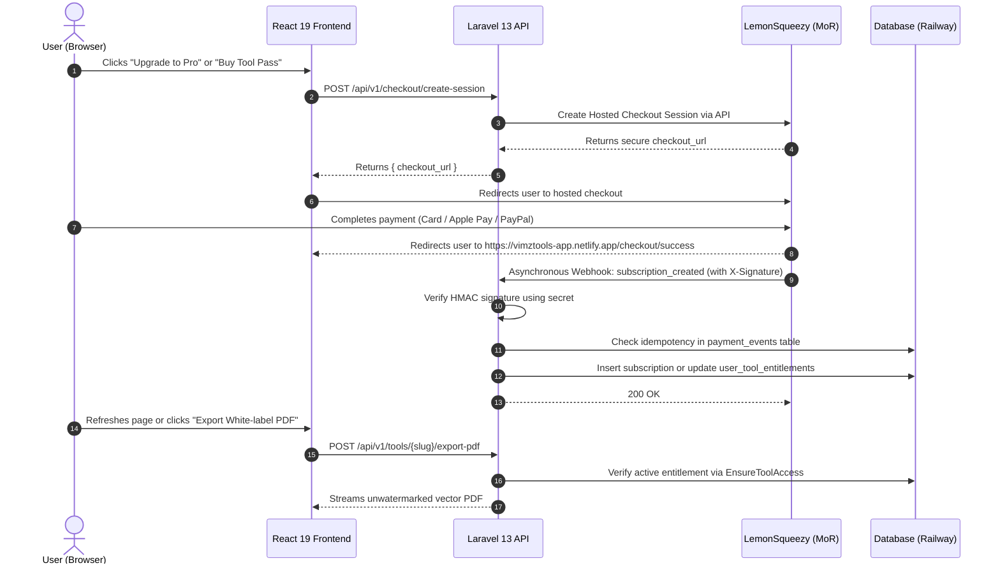

# Vimz.ai — Payment Provider Research & Pakistan Eligibility Analysis
**Global Monetization, Merchant of Record (MoR) Evaluation, Banking & Tax Compliance**

* **Status:** Complete Market Research & Architecture Assessment
* **Date:** October 12, 2026
* **Location Context:** Project and Founders Based in Pakistan
* **Target Audience:** International SaaS Users, Agencies, Freelancers, and Local Professionals
* **Associated Documents:**
  - Hybrid Architecture: [`05-hybrid-monetization-architecture.md`](file:///c:/Users/ranah/OneDrive/Desktop/vimztools/reports/vimz-ai-freemium-audit/05-hybrid-monetization-architecture.md)
  - Security Threat Model: [`12-security-threat-model-and-persistence-audit.md`](file:///c:/Users/ranah/OneDrive/Desktop/vimztools/reports/vimz-ai-freemium-audit/12-security-threat-model-and-persistence-audit.md)

---

## 1. Executive Summary

Monetizing a global SaaS product from Pakistan requires navigating two distinct challenges:
1. **International Card Acceptance & Recurring Billing:** The majority of high-ticket agency and pro users pay in USD via global credit cards (Visa, MasterCard, Amex) or Apple Pay/Google Pay/PayPal.
2. **Cross-Border Payouts & Global Tax Compliance:** International sales are subject to local digital services taxes (EU VAT, US State Sales Taxes, UK VAT). Setting up tax registrations across 50+ jurisdictions is impractical for a growing startup.

### The Critical Architectural Choice
We evaluated the two primary monetization paradigms:
* **Traditional Payment Gateways (Stripe, Braintree):** You act as the merchant. You must incorporate a business in an eligible country (e.g., US LLC via Stripe Atlas) and manage global sales tax filings yourself.
* **Merchant of Record (MoR) Platforms (LemonSqueezy, Paddle):** The MoR acts as the legal reseller. They collect payments, handle 100% of global tax filings/invoicing, manage chargebacks, and transfer net profits directly to your Payoneer or Wise bank account in Pakistan.

---

## 2. Comprehensive Provider Evaluation Matrix

| Provider | Merchant Model | Direct Pakistan Support? | Supported Payout Methods | Recurring Subscriptions | Single-Tool Purchases | Global Tax & VAT Handling | Transaction Fees | Overall Verdict |
| :--- | :---: | :---: | :--- | :---: | :---: | :---: | :---: | :--- |
| **LemonSqueezy** | **Merchant of Record (MoR)** | **YES** | Payoneer, Wise, Direct International Wire | **Native & Automated** | **Native** | **100% Handled Globally** | 5% + \$0.50 per sale | **TOP RECOMMENDATION** (Zero foreign LLC needed; built for digital SaaS products). |
| **Paddle** | **Merchant of Record (MoR)** | **YES** | Payoneer, Wire Transfer | **Native & Automated** | **Native** | **100% Handled Globally** | 5% + \$0.50 per sale | **STRONG ALTERNATIVE** (Enterprise-grade SaaS focus; slightly stricter onboarding). |
| **Stripe** | Payment Gateway | **NO** (Requires US/UK LLC) | US/UK Bank Account | **Native (Stripe Billing)** | **Native** | Requires Stripe Tax + manual filing | 2.9% + \$0.30 (plus \$500 LLC setup) | Viable only if Sir already operates a US/UK business entity. |
| **Safepay (Pakistan)** | Local PSP | **YES** | Local Pakistani PKR Bank Account | Limited / Manual Card Tokenization | **Native** | Merchant responsible | ~2.5% to 3.3% + PKR fee | Great for local Pakistani customers, but lacks global subscription capabilities. |
| **PayFast / JazzCash** | Local PSP | **YES** | Local PKR Bank Account | No native global subscription | **Native** | None | ~2.5% + PKR fee | Domestic Pakistani market only. |

---

## 3. Why LemonSqueezy is the Optimal Choice for Vimz.ai

1. **Zero Foreign Corporate Overhead:**
   LemonSqueezy does not require registering a US LLC or UK Ltd company. Pakistani residents can sign up as an individual or local business with a Pakistani passport/CNIC and receive earnings via Payoneer or Wise.
2. **Turnkey Tax & VAT Compliance:**
   When a customer in Germany or California purchases the \$12.99 Pro subscription, LemonSqueezy automatically calculates, collects, and remits the correct European VAT or US Sales Tax. Vimz.ai receives net revenue with zero cross-border tax liability.
3. **Dual Monetization Native Support:**
   LemonSqueezy natively handles both **recurring monthly subscriptions** (with automatic dunning, retries, and customer portal for cancellations) and **one-time digital products** (for single-tool passes).
4. **Clean Webhook Architecture for Laravel:**
   LemonSqueezy provides an official Laravel package (`lemonsqueezy/laravel`) with built-in subscription management, HMAC webhook verification, and checkout session redirects.

---

## 4. End-to-End Webhook & Entitlement Flow

---

## 5. External Actions Required to Activate Live Billing

To transition from sandboxed testing to live commercial revenue, Sir will need to complete the following external administrative steps:

1. **Register a LemonSqueezy Account:**
   - Go to [lemonsqueezy.com](https://www.lemonsqueezy.com) and create a store named `Vimz.ai`.
   - Complete standard identity verification (KYC) using a Pakistani passport or National Identity Card (CNIC).
2. **Connect Payout Account:**
   - Link a verified **Payoneer** or **Wise** USD receiving account connected to a Pakistani bank.
3. **Configure Webhook Endpoint:**
   - In LemonSqueezy Store Settings $\to$ Webhooks:
     - URL: `https://charming-vitality-production-dd02.up.railway.app/api/v1/webhooks/lemonsqueezy`
     - Events: `subscription_created`, `subscription_updated`, `subscription_cancelled`, `order_created`, `order_refunded`.
     - Generate a secure **Webhook Secret**.
4. **Provide Environment Secrets to Railway:**
   - Add these three variables in the Railway dashboard:
     - `LEMONSQUEEZY_API_KEY=...`
     - `LEMONSQUEEZY_STORE_ID=...`
     - `LEMONSQUEEZY_WEBHOOK_SECRET=...`

*Note: While awaiting live account setup, all local development, extension building, and backend integration can be thoroughly tested using LemonSqueezy's built-in **Test Mode (Sandbox)** with zero financial risk.*
