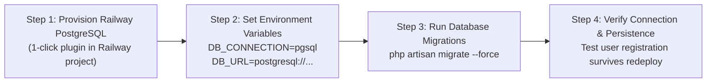

# Vimz.ai — Security Threat Model & Persistence Audit
**Master Security Architecture, Threat Mitigation & Database Resilience Blueprint**

* **Status:** Complete Technical Threat Model & Infrastructure Audit
* **Date:** October 12, 2026
* **Target Stack:** React 19 SPA (Netlify) + Laravel 13 API (Railway) + Chrome Extension (Manifest V3)
* **Associated Documents:**
  - Hybrid Architecture: [`05-hybrid-monetization-architecture.md`](file:///c:/Users/ranah/OneDrive/Desktop/vimztools/reports/vimz-ai-freemium-audit/05-hybrid-monetization-architecture.md)
  - Payment Research: [`11-payment-provider-research-and-pakistan-eligibility.md`](file:///c:/Users/ranah/OneDrive/Desktop/vimztools/reports/vimz-ai-freemium-audit/11-payment-provider-research-and-pakistan-eligibility.md)

---

## 1. STRIDE Threat Model & Engineering Mitigations

We applied the Microsoft STRIDE security threat modeling framework across the Vimz.ai ecosystem:

```
┌────────────────────────────────────────────────────────────────────────┐
│                        STRIDE SECURITY THREAT MATRIX                   │
├────────────────────┬─────────────────────┬─────────────────────────────┤
│ Threat Category    │ Potential Vector    │ Architectural Mitigation    │
├────────────────────┼─────────────────────┼─────────────────────────────┤
│ Spoofing           │ Fake Webhook Events │ HMAC SHA-256 Signature      │
│                    │ & Impersonated Users│ Verification on all webhooks│
├────────────────────┼─────────────────────┼─────────────────────────────┤
│ Tampering          │ DevTools attribute  │ Backend authoritative check │
│                    │ editing in browser  │ via `EnsureToolAccess` MW   │
├────────────────────┼─────────────────────┼─────────────────────────────┤
│ Repudiation        │ Disputes on tool    │ Immutable `payment_events`  │
│                    │ purchases / refunds │ audit logging with raw JSON │
├────────────────────┼─────────────────────┼─────────────────────────────┤
│ Information        │ Scraping user data  │ Strict user ID scoping on   │
│ Disclosure         │ or exposing tokens  │ all saved projects (no IDOR)│
├────────────────────┼─────────────────────┼─────────────────────────────┤
│ Denial of Service  │ Excessive batch PDF │ Rate limiting (30 req/min), │
│                    │ generation requests │ 128 MB RAM cap, 15s timeout │
├────────────────────┼─────────────────────┼─────────────────────────────┤
│ Elevation of       │ Bypassing paywall   │ Entitlements validated in   │
│ Privilege          │ via Chrome extension│ Laravel DB, never in client │
└────────────────────┴─────────────────────┴─────────────────────────────┘
```

---

## 2. Deep Dive: Key Security Mitigations

### 2.1 The Client-Side Paywall Vulnerability
* **Attack Scenario:** An attacker opens Chrome DevTools, inspects an unbranded PDF export button with `disabled={!isPro}`, removes the `disabled` attribute, or modifies React state (`setIsPro(true)`).
* **Mitigation:** The frontend UI is treated strictly as an untrusted client. The actual high-resolution, unwatermarked PDF vector file is compiled exclusively by the Laravel backend at `POST /api/v1/tools/{slug}/export-pdf`. The backend queries the `subscriptions` and `purchases` tables before streaming the file. If unauthorized, the backend returns `403 Forbidden`. Tampering with the client DOM achieves nothing.

### 2.2 Webhook Forgery & Replay Attacks
* **Attack Scenario:** An adversary sniffs an old `subscription_created` webhook and re-sends it to the API to extend their subscription for free.
* **Mitigation:**
  1. Every incoming webhook must have a valid `X-Signature` HMAC hash computed with the gateway's shared secret.
  2. The webhook's unique `event_id` is recorded in the `payment_events` table before processing.
  3. If an event ID already exists in the table, the controller terminates immediately and returns `200 OK` without modifying user privileges.

### 2.3 HTML & PDF Injection Prevention
* **Attack Scenario:** A malicious user types `<script>` or `<iframe src="...">` into their custom company name or invoice notes to trigger code execution in the PDF rendering engine.
* **Mitigation:** All dynamic values passed to Dompdf Blade templates are escaped using `htmlspecialchars($value, ENT_QUOTES, 'UTF-8')`. Remote script execution is disabled in the Dompdf configuration (`$dompdf->set_option('isJavascriptEnabled', false)`).

### 2.4 Insecure Direct Object References (IDOR)
* **Attack Scenario:** A user tries to download someone else's saved project or invoice by guessing `/api/v1/projects/{id}`.
* **Mitigation:** Every project lookup is explicitly scoped to the authenticated user ID:
  ```php
  $project = SavedProject::where('user_id', $request->user()->id)->findOrFail($id);
  ```

---

## 3. Database Persistence Audit & Migration Blueprint

### 3.1 Current Architecture Inspection
Inspection of `api/Dockerfile`, `api/railway.json`, and `render.yaml` confirms:
* Railway currently launches the backend container with an ephemeral SQLite database file at `/var/www/html/database/database.sqlite`.
* Container redeployments rebuild the image from scratch and re-run migrations, erasing all prior records.
* **Conclusion:** This setup cannot hold live customer accounts, payment receipts, or subscriptions.

### 3.2 Transition Plan to Managed PostgreSQL on Railway



#### Step-by-Step Migration Blueprint:
1. **Provision Managed PostgreSQL on Railway:**
   - In the Railway project dashboard, click **+ New Service** $\to$ **Database** $\to$ **Add PostgreSQL**.
   - Railway instantly provisions a high-availability PostgreSQL 16 database.
2. **Configure Environment Variables:**
   - Connect the PostgreSQL database to the `vimztools-api` service. Railway automatically injects `DATABASE_URL`.
   - Update `render.yaml` / Railway service variables:
     - `DB_CONNECTION=pgsql`
     - `DATABASE_URL=${{Postgres.DATABASE_URL}}`
3. **Run Initial Migrations:**
   - On the next container startup, `php artisan migrate --force` will execute automatically against the persistent PostgreSQL instance.
   - The PHP container **already has `pdo_pgsql` compiled in Dockerfile** (line 13), ensuring seamless compatibility.
4. **Automated Daily Backups:**
   - Railway PostgreSQL includes automated snapshot backups with point-in-time recovery.
   - A weekly export of the database dump (`pg_dump`) can be stored in secure cold storage.

---

## 4. Temporary File Cleanup & Storage Protection

When users generate unwatermarked PDFs, files should be streamed directly to output or written to temporary storage.
* **Direct Stream:** `return $pdf->stream('invoice.pdf');` (zero disk write; zero leftover files).
* **Temporary Disk Buffer (for batch exports):**
  - Files are written to `storage/app/exports/tmp_{uuid}.pdf`.
  - Directory permissions restricted to `chmod 700`.
  - A scheduled Laravel command runs hourly:
    ```php
    Storage::disk('local')->delete(
        collect(Storage::disk('local')->files('exports'))
            ->filter(fn($f) => now()->subMinutes(15)->timestamp > Storage::disk('local')->lastModified($f))
    );
    ```
